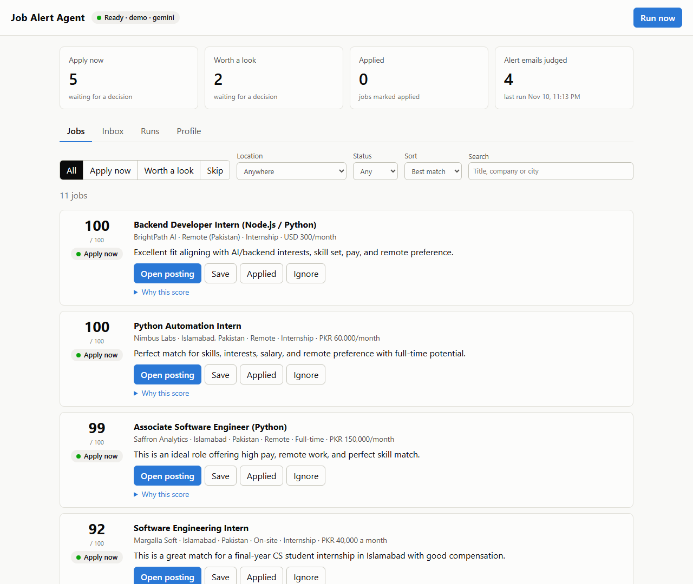
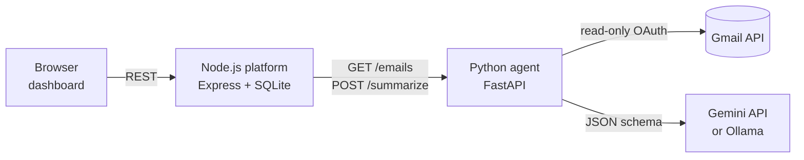
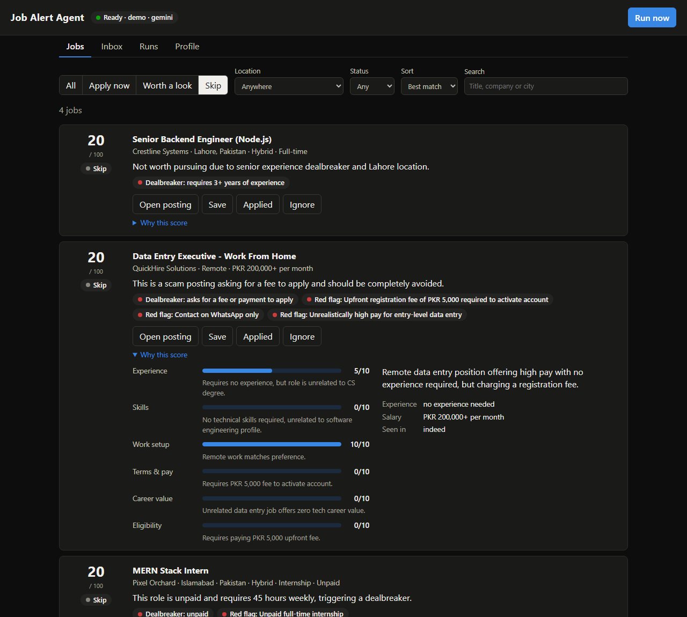
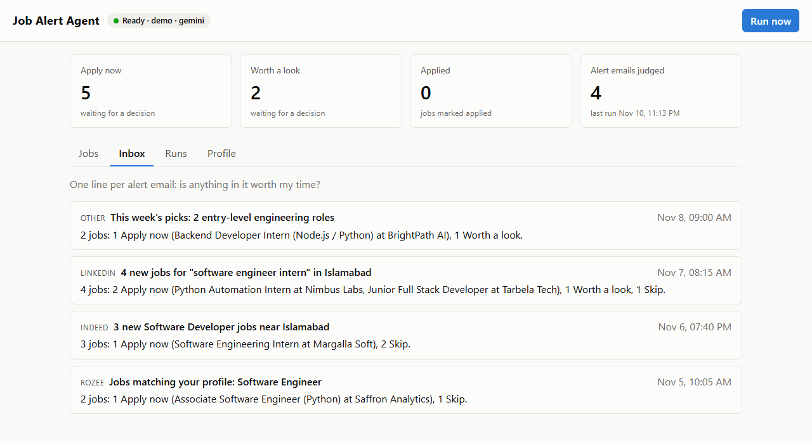

# Job Alert Agent

An AI agent that reads my job-alert emails (LinkedIn, Indeed, Glassdoor, Rozee.pk), pulls out every job in them, and tells me **how useful each job is to me**, with the reasons. Each job gets a verdict: **Apply now**, **Worth a look** or **Skip**.

It's built as two services: a **Node.js core platform** (REST API, SQLite storage, dashboard) and a **Python automation layer** (Gmail integration, email parsing, LLM judging). It runs entirely on free tiers.



*Screenshots use the fictional demo data that ships with the repo.*

---

## Contents

- [Why I built it](#why-i-built-it)
- [Features](#features)
- [How it works](#how-it-works)
- [How a job is judged](#how-a-job-is-judged)
- [Tech stack](#tech-stack)
- [Quick start (demo, no accounts needed)](#quick-start-demo-no-accounts-needed)
- [Judge new emails with Gemini](#judge-new-emails-with-gemini)
- [Connect your Gmail](#connect-your-gmail)
- [Your profile](#your-profile)
- [Configuration](#configuration)
- [REST API](#rest-api)
- [Project structure](#project-structure)
- [Tests](#tests)
- [Engineering decisions](#engineering-decisions)
- [Privacy and security](#privacy-and-security)
- [Troubleshooting](#troubleshooting)
- [Known limitations](#known-limitations)
- [Roadmap](#roadmap)
- [How I built it](#how-i-built-it)
- [License](#license)

---

## Why I built it

Job boards send a lot of alert emails, and most of the jobs in them don't fit: wrong seniority, wrong city, unpaid, or outright scams. Opening every email to find the one or two worth applying to takes time. This agent answers one question for each email: *"Is anything in here worth my time, and why?"*

## Features

- **Reads job alerts from Gmail** through the Gmail API with read-only access, or from built-in sample emails in demo mode.
- **Extracts every job in an email**: title, company, location, country, work mode, pay, hours, experience required, deadline and the apply link.
- **Judges each job against my profile** on six factors, with a one-line reason for each rating, then gives an overall score out of 100 and a verdict.
- **Dealbreakers and red flags.** Things like "unpaid" or "asks for a fee to apply" force a Skip, and warning signs (WhatsApp-only contact, unrealistic pay, long bonds) are flagged.
- **One-line summary per email**, for example *"4 jobs: 1 Apply now (Python Automation Intern at Nimbus Labs), 2 Worth a look, 1 Skip."*
- **Dashboard** to filter by verdict, status and location (for example *Pakistan only*), search, expand "Why this score", and mark jobs saved, applied or ignored.
- **Never judges the same email twice**, and stores a job seen in several alerts only once.
- **Free to run**: Gemini's free tier by default, or a fully local model through Ollama.

## How it works



| Layer | Folder | Responsibility |
|---|---|---|
| **Core platform** | `server/` | Runs each fetch-and-judge run, stores results in SQLite, removes duplicates, serves the REST API and the dashboard |
| **Automation layer** | `agent/` | Talks to the outside world: fetches emails from Gmail, cleans them up, calls the LLM, scores the result. It stores nothing. |

**What happens when you click "Run now":**

1. The platform asks the agent for alert emails from the last 7 days.
2. It skips any email it has already judged, so nothing is sent to the LLM twice.
3. For each new email, the agent strips the HTML, calls the LLM with a JSON schema, validates the answer and works out the scores.
4. The platform saves the email and its jobs in one transaction, and stores a job that appeared in an earlier alert only once.
5. The dashboard shows the results. The run's progress is saved after every email, so it's visible while it runs.

## How a job is judged

The LLM reads the email and rates each job from 0 to 10 on six factors, with a short reason for each:

| Factor | Default weight | What it checks |
|---|---:|---|
| Experience | 25 | Years and seniority asked for vs. mine |
| Skills | 25 | Must-have and nice-to-have skills I have, and the ones I'm missing |
| Work setup | 15 | Remote, hybrid or onsite, city, and working hours (for example night shifts for another timezone) |
| Terms & pay | 15 | Paid or unpaid, amount vs. my minimum, hours, contractor vs. employee, bonds |
| Career value | 10 | Path to full-time, mentorship, relevance to my target roles and interests |
| Eligibility | 10 | Degree, citizenship, language, deadlines, equipment |

**Python, not the LLM, decides the outcome:**

- **Overall score** = the weighted average of the six ratings, scaled to 0–100. The weights come from my profile.
- **Dealbreakers** listed in my profile cap the score at 20 and force **Skip**. A dealbreaker the model names that isn't in my profile is ignored.
- **Verdict:** 75 and above is **Apply now**, 50–74 is **Worth a look**, below 50 is **Skip**. Both thresholds can be changed in the profile.
- **Apply links:** the model only refers to links by short tags such as `[L3]`, which Python maps back to the real URL, so a link can never be made up.



## Tech stack

| Area | Choice |
|---|---|
| Core platform | Node.js 22.13+, Express 5, built-in `node:sqlite` (no native build step) |
| Automation layer | Python 3.11+, FastAPI, Pydantic |
| Email | Gmail API (`google-api-python-client`, OAuth with the `gmail.readonly` scope); IMAP with an App Password as a backup |
| Parsing | Python's `email` package and BeautifulSoup |
| LLM | Google Gemini free tier (`google-genai` SDK, JSON-schema output), or Ollama for a local model |
| Dashboard | Plain HTML, CSS and JavaScript (no build step), light and dark mode |
| Tests | `pytest` and `node:test` |

## Quick start (demo, no accounts needed)

You'll need **Python 3.11+** and **Node.js 22.13+**. Demo mode reads the fictional sample emails in [`agent/samples/`](agent/samples/), so you don't need Gmail or an API key to look around.

**1. Start the Python agent** (terminal 1)

```bash
cd agent
python -m venv .venv
# Windows:      .venv\Scripts\activate
# macOS/Linux:  source .venv/bin/activate
pip install -r requirements.txt
cp .env.example .env          # Windows PowerShell: copy .env.example .env
uvicorn app.main:app --reload --reload-include .env --port 8000
```

**2. Start the Node platform** (terminal 2)

```bash
cd server
npm install
npm run seed     # loads 11 already-judged demo jobs, so the dashboard isn't empty
npm run dev
```

**3. Open http://localhost:3000.**

The pill at the top left should say **Ready · demo · gemini**. Port 8000 is the agent's API, not a web page: it answers `{"detail":"Not Found"}` at `/`, but has interactive API docs at http://localhost:8000/docs.

**What's on the dashboard:**

- **Jobs:** every job with its score and verdict. Filter by verdict, location and status, search, and expand **Why this score**.
- **Inbox:** one line per alert email.
- **Runs:** the history of runs. **Run now** starts a new one.
- **Profile:** the skills, preferences, weights and dealbreakers every job is judged against.



## Judge new emails with Gemini

To judge emails rather than only view the demo results, you need an LLM.

1. **Get a free Gemini API key** at https://aistudio.google.com (no credit card), and set it in `agent/.env`:
   ```
   GEMINI_API_KEY=your-key
   GEMINI_MODEL=gemini-3.5-flash
   ```
   Google renames and retires models often. If you get a "model not found" error, pick a current Flash model from AI Studio.
2. **Try it from the terminal**, without the dashboard:
   ```bash
   cd agent
   python -m app.cli              # judge the sample emails
   python -m app.cli --limit 1    # just one email
   ```

**Prefer to keep everything on your laptop?** Install [Ollama](https://ollama.com), run `ollama pull qwen2.5:7b`, and set `LLM_PROVIDER=ollama`. It's slower and needs about 8 GB of RAM, but nothing leaves your machine.

## Connect your Gmail

This is a one-time setup in Google Cloud and takes about 15 minutes. The agent asks only for **read-only** access, and you can revoke it at any time under *Google Account → Security → Third-party connections*.

1. **Create a project** at https://console.cloud.google.com and enable the **Gmail API** (*APIs & Services → Library*).
2. **Set up the consent screen** (*Google Auth Platform*, or *APIs & Services → OAuth consent screen*):
   - choose **External**,
   - add your own address under **Test users**,
   - add the `.../auth/gmail.readonly` scope.
3. **Create an OAuth client** of type **Desktop app**, download the JSON file, rename it to `credentials.json` and put it in `agent/`.
4. **Sign in once:**
   ```bash
   cd agent
   python -m app.auth_gmail
   ```
   A browser opens. When it says *"Google hasn't verified this app"*, click **Continue**; that's expected for a personal app. The sign-in is saved to `agent/token.json`.
5. **Switch the agent to Gmail** in `agent/.env`, choosing which emails count as job alerts:
   ```
   EMAIL_PROVIDER=gmail
   # Match alert senders (works straight away):
   GMAIL_QUERY=from:(jobalerts-noreply@linkedin.com OR jobs-noreply@linkedin.com OR indeed.com OR glassdoor.com OR rozee.pk) newer_than:7d
   # ...or, if you've made a Gmail filter that labels alerts "Job Alerts":
   # GMAIL_QUERY=label:"Job Alerts" newer_than:7d
   ```
   The query uses the same syntax as Gmail's search box.
6. Restart the agent, then click **Run now**.

While the Google app is in **Testing** mode, Google expires the sign-in after 7 days; run `python -m app.auth_gmail` again when that happens. Choosing **Publish app** under *Audience* avoids this, and personal use doesn't need Google's verification.

`credentials.json`, `token.json` and `.env` are git-ignored.

## Your profile

Every job is judged against a profile: experience level, skills (strong, familiar, learning), target roles, locations, remote preference, minimum pay, dealbreakers, factor weights and verdict thresholds.

- Copy [`profile.example.json`](profile.example.json) to **`profile.json`** in the repo root and fill in your own details. `profile.json` is git-ignored.
- Or edit it in the dashboard's **Profile** tab. The agent checks the profile before it's saved and rejects invalid values, such as a negative weight.

A few things to know:

- **A profile saved from the dashboard takes priority over `profile.json`.** Deleting the database removes the saved copy.
- **Changing the profile affects only emails judged afterwards.** Jobs keep the score they were given.
- Example dealbreakers: `"unpaid"`, `"asks for a fee or payment to apply"`, `"requires 3+ years of experience"`, `"located outside Pakistan"`.

## Configuration

**Agent (`agent/.env`):** see [`agent/.env.example`](agent/.env.example).

| Variable | Default | Purpose |
|---|---|---|
| `EMAIL_PROVIDER` | `demo` | Where emails come from: `demo`, `gmail` or `imap` |
| `GMAIL_QUERY` | `label:"Job Alerts" newer_than:3d` | Gmail search that selects job alerts |
| `GMAIL_CREDENTIALS_FILE` / `GMAIL_TOKEN_FILE` | `credentials.json` / `token.json` | OAuth client and saved sign-in |
| `GMAIL_USER` / `GMAIL_APP_PASSWORD` | – | IMAP backup only |
| `LLM_PROVIDER` | `gemini` | `gemini` or `ollama` |
| `GEMINI_API_KEY` | – | Free key from AI Studio |
| `GEMINI_MODEL` | `gemini-3.5-flash` | Any current Gemini Flash model |
| `OLLAMA_URL` / `OLLAMA_MODEL` | `http://localhost:11434` / `qwen2.5:7b` | Local model option |

**Platform (`server/.env`, optional):** see [`server/.env.example`](server/.env.example).

| Variable | Default | Purpose |
|---|---|---|
| `PORT` | `3000` | Dashboard and API port |
| `AGENT_URL` | `http://localhost:8000` | Where the Python agent runs |
| `DB_FILE` | `server/data/jobs.db` | SQLite file, created automatically |
| `LOOKBACK_DAYS` | `7` | How far back each run looks for emails |
| `FETCH_LIMIT` | `25` | Maximum emails fetched per run |
| `SUMMARIZE_DELAY_MS` | `2000` | Pause between LLM calls, to stay inside free-tier limits |
| `MAX_EMAIL_ATTEMPTS` | `3` | How many times a failing email is retried across runs |

## REST API

**Python agent** (port 8000; interactive docs at `/docs`)

| Method | Path | Purpose |
|---|---|---|
| `GET` | `/health` | Status, and which email and LLM providers are active |
| `GET` | `/emails?since=&limit=` | Fetch alert emails, cleaned for the LLM |
| `POST` | `/summarize` | `{email, profile}` → every job in the email, scored, plus the one-line summary |
| `POST` | `/profile/validate` | Check a profile and fill in defaults |

`/summarize` errors tell the caller what to do: **429** means retry later (rate limit, or the model is overloaded), **503** means a setup problem (no key, Gmail sign-in expired), **502** means the model gave an unusable answer for that one email.

**Node platform** (port 3000)

| Method | Path | Purpose |
|---|---|---|
| `GET` | `/api/jobs?verdict=&status=&country=&worldwide=1&minScore=&q=&sort=score\|newest` | List, filter and search jobs |
| `GET` / `PATCH` | `/api/jobs/:id` | One job; `PATCH {"status": "applied"}` sets its status |
| `GET` | `/api/emails` | Inbox view: one row per alert email |
| `POST` | `/api/runs` | Start a run (`202`, or `409` if one is already running) |
| `GET` | `/api/runs`, `/api/runs/:id` | Run history and progress |
| `GET` / `PUT` | `/api/profile` | Read or save the profile (validated by the agent) |
| `GET` | `/api/stats` | Headline numbers for the dashboard |
| `GET` | `/api/health` | Platform and agent status |

## Project structure

```
emailAgent/
├── agent/                      Python automation layer (FastAPI)
│   ├── app/
│   │   ├── main.py             API routes and error-to-status mapping
│   │   ├── models.py           Pydantic models: email, profile, extracted job, scored job
│   │   ├── parser.py           Raw email → clean text, tracking links → [Ln] refs
│   │   ├── providers/          Email sources: gmail_api.py, imap.py, demo.py
│   │   ├── llm/                LLM providers: gemini.py, ollama.py
│   │   ├── summarizer.py       Prompt, schema, validation and retry
│   │   ├── scoring.py          Weighted score, dealbreakers, verdicts, apply links
│   │   ├── auth_gmail.py       One-time Gmail sign-in
│   │   └── cli.py              Try the agent from the terminal
│   ├── samples/                Fictional job-alert emails for demo mode
│   └── tests/
├── server/                     Node.js core platform (Express)
│   ├── src/
│   │   ├── pipeline.js         One run: fetch, skip known emails, judge, store
│   │   ├── repo.js             All SQL queries
│   │   ├── db.js               Schema and migrations
│   │   ├── dedupe.js           Spots the same job across alerts
│   │   ├── country.js          Country from city and state names
│   │   ├── agentClient.js      HTTP client for the agent, with timeouts
│   │   └── routes/             REST endpoints
│   ├── public/                 Dashboard (HTML, CSS, JS)
│   ├── fixtures/               Demo results loaded by `npm run seed`
│   ├── scripts/seed.js
│   └── test/
├── profile.example.json        Example profile (copy to profile.json)
├── docs/screenshots/
└── PLAN.md                     Original design plan and milestones
```

## Tests

```bash
cd agent && python -m pytest     # 101 tests
cd server && npm test            # 55 tests
```

The tests never call a real LLM or Gmail. Both are replaced with fakes, so the suites are free, fast and repeatable. They cover:

- email parsing,
- the Gmail, IMAP and demo providers,
- the Gemini and Ollama providers, including error mapping,
- scoring and verdict rules,
- the summariser's retry on invalid output,
- duplicate detection and the database migration,
- the run pipeline's handling of each kind of failure,
- every API route.

## Engineering decisions

- **The LLM rates, Python decides.** The model only extracts facts and rates factors. Scores, verdicts, dealbreakers and links are worked out in plain Python, so they're explainable, testable and tunable, and the model can't make one up.
- **Structured output, validated twice.** The LLM must answer in a JSON schema generated from the Pydantic models. The answer is validated again, and an invalid one gets a single retry that includes the validation error.
- **One parser for every source.** The Gmail API (raw format), IMAP and the sample files all produce standard RFC 822 email, so they share one parser.
- **Short link refs.** Job-alert links are long tracking URLs. Replacing them with `[L1]`, `[L2]`… saves tokens and keeps the model from making up links.
- **Errors carry meaning.** A rate limit or an overloaded model stops the run and leaves the remaining emails for next time. A setup problem stops the run as failed. A bad answer for one email is recorded, the run carries on, and that email is retried later, up to a limit.
- **Runs are idempotent.** Emails are recorded once judged, jobs are de-duplicated by normalised company and title, runs never overlap, and a run cut short by a restart is closed when the server starts again.
- **Built for free tiers.** No email is judged twice, HTML is stripped before it's sent, calls are spaced out, transient errors are retried with backoff, and every request has a timeout.
- **Swappable providers.** Email (Gmail API, IMAP, demo) and the LLM (Gemini, Ollama) each sit behind a small interface, chosen by one setting.

## Privacy and security

- **Read-only Gmail access** (`gmail.readonly`). The agent can't send, delete or change email. IMAP also opens the mailbox read-only, so nothing is marked as read.
- **Emails are untrusted input.** The prompt tells the model to ignore any instructions inside an email. The dashboard inserts all job text with `textContent`, never `innerHTML`, and only links that start with `http://` or `https://` are shown.
- **Secrets and personal data stay local.** `.env`, `credentials.json`, `token.json`, `profile.json` and the database are git-ignored. The demo data in this repo is entirely fictional.
- **What leaves your machine:** with Gemini, each new alert email's cleaned text and your profile are sent to Google. On the free tier, Google may use that content to improve its products. Use Ollama to keep everything local.

## Troubleshooting

| Symptom | Cause and fix |
|---|---|
| Pill says **Agent offline** | The Python agent isn't running. Start it in `agent/` (step 1 of the quick start). |
| `{"detail":"Not Found"}` at http://localhost:8000 | Expected. That's the agent's API; the dashboard is at http://localhost:3000. |
| `npm error ... Could not read package.json` | `npm` was run in `agent/`. Run it in `server/`. |
| **Run now** finishes with 0 new emails | Check that `GMAIL_QUERY` matches your inbox (a `label:` query needs that label to exist), then restart the agent. It reads `.env` only at startup, unless started with `--reload-include .env`. |
| `Input should be 'demo', 'gmail' or 'imap'` | `EMAIL_PROVIDER` has a wrong value, for example `gemini`. Gemini belongs in `LLM_PROVIDER`. |
| Run stops with **"Gemini is temporarily unavailable"** | The model is overloaded. Wait and run again; it continues where it stopped. If it keeps happening, try another Flash model. |
| **Gemini model not found** | That model is retired or closed to new users. Set `GEMINI_MODEL` to a current one from AI Studio. |
| **Gmail sign-in has expired** | Run `python -m app.auth_gmail` again, or publish the Google app (see [Connect your Gmail](#connect-your-gmail)). |
| A changed profile isn't used | A profile saved from the dashboard overrides `profile.json`. Edit it in the Profile tab instead. |

## Known limitations

- **Scores vary slightly between runs.** The same job can score a couple of points differently, so jobs near a threshold may flip between verdicts.
- **Strong matches often score 100,** which makes the very best jobs hard to tell apart.
- **Profile changes don't re-score stored jobs.**
- **The summary tiles count jobs from every country** and don't follow the Location filter.
- **Country guessing from place names** covers Pakistan and Australia only. Other countries rely on the LLM.
- **Runs are started by hand.** Scheduled runs are next on the roadmap.

## Roadmap

- [x] Email ingestion: Gmail API, IMAP backup, demo samples
- [x] LLM judging with Gemini or Ollama, plus Python scoring
- [x] Storage, run pipeline and duplicate detection
- [x] Dashboard, demo seed data and the country filter
- [ ] Scheduled runs, and showing the active Gmail query and profile source in the dashboard
- [ ] GitHub Actions running both test suites
- [ ] Gmail push notifications instead of polling
- [ ] Daily digest email, and a drafted cover-letter starter for strong matches

## How I built it

I built this with **Claude Code** as an AI pair programmer.

- **My part:** I set the requirements and made the design calls:
  - two services, Node.js and Python,
  - read-only Gmail API access over passwords,
  - free LLMs only,
  - scoring decided in code rather than by the model,
  - a Pakistan location filter once my real alerts turned out to be for Australia.

  I approved each milestone before the next one started, and ran the agent against my own inbox.
- **What testing on real data found:** a schema bug that Gemini rejected, overloaded and retired models, and confusing setup steps. Each was fixed with a regression test, and the troubleshooting table above comes from those problems.
- **Process:** the work was done in milestones (see [PLAN.md](PLAN.md)), with small commits following [Chris Beams' commit message guidelines](https://cbea.ms/git-commit/).

## License

[MIT](LICENSE) © 2026 Maheen Khan
